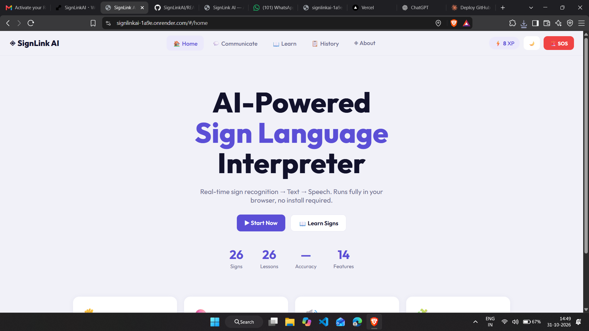
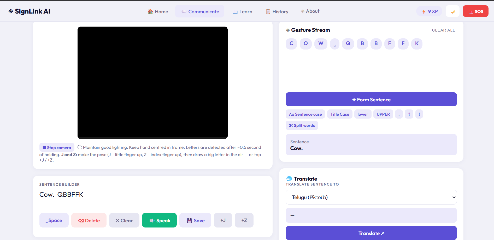
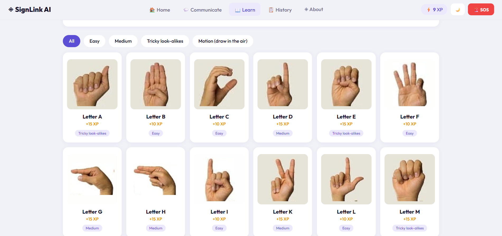
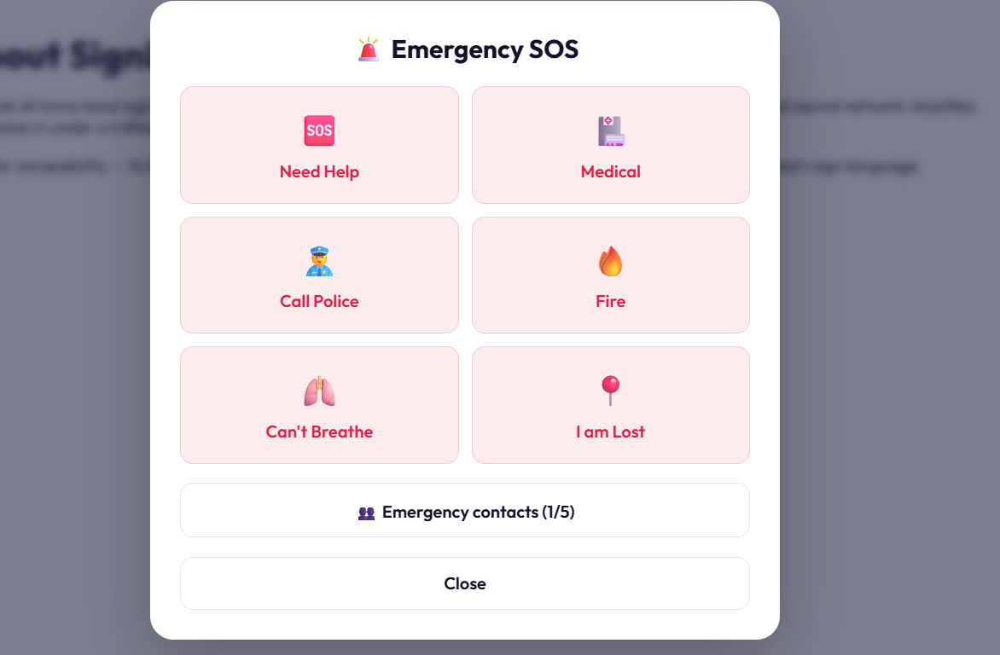

# SignLink AI

**AI-powered sign language interpreter.** SignLink AI recognises American Sign Language (ASL) fingerspelling through your webcam and turns it into text and speech, in real time, right in your browser.

## 🔗 Live Demo

**👉 https://signlinkai-1a9e.onrender.com**

> The app is hosted on a free server, so the first load may take up to a minute. Please allow camera access when asked.

## Screenshots

| Home | Communicate |
|---|---|
|  |  |

| Learn | Emergency SOS |
|---|---|
|  |  |

## About

Many deaf and hard-of-hearing people find it hard to communicate with those who don't know sign language. SignLink AI bridges that gap: sign in front of your camera, and the app builds the words, forms a sentence, translates it, and speaks it aloud.

## Features

- **Real-time sign recognition**: detects 24 static ASL letters (A–Y, except J) from your webcam
- **Motion letters**: draw **J** and **Z** in the air after making the starting pose
- **Gesture Stream and Sentence Builder**: build words with Space, Delete, Clear and Save controls
- **Form Sentence**: automatically fixes spacing, capitalisation and punctuation (`ILOVEYOU → I love you.`)
- **Text-to-Speech**: reads your sentence aloud as words and names
- **Translation**: translate sentences into Hindi, Telugu, Tamil and many other languages, and listen to the result
- **Learn Signs**: practice page with real hand photos for every letter, difficulty levels and XP points
- **History**: view your saved sentences
- **Emergency SOS**: one-tap alerts for Need Help, Medical, Police, Fire, Can't Breathe and I am Lost, with a full-screen message, call button and location sharing
- **Emergency contacts**: save up to 5 contacts to notify during an SOS
- **Light and dark mode**

## How to use

1. Open the **Communicate** page and click **Start camera**.
2. Keep your hand centred in the frame, palm facing the camera, in good lighting.
3. Hold each sign steadily for about half a second to add the letter.
4. For **J** or **Z**, make the starting pose (J = little finger up, Z = index finger up) and draw the letter in the air. You can also tap the **+J / +Z** buttons.
5. Tap **Form Sentence** to clean up the text, **Translate** to change the language, or **Speak** to hear it.

## Accuracy

- About **91 %** accuracy on the 24 static letters, tested on a different dataset (other people and cameras).
- Letters that look alike, such as **M, N and D**, are the hardest to tell apart.
- Best results come from a plain background, good light and a fully visible hand.

## Tech Stack

- **Frontend:** HTML, CSS, JavaScript
- **Hand tracking:** MediaPipe Hands
- **Recognition:** pretrained neural network running in the browser
- **Backend:** Python, FastAPI
- **Speech:** Web Speech API
- **Translation:** Gemini API with free translation fallbacks

## Credits

Learn page hand photos are cropped from an ASL chart from the Gérard Aflague Collection (© its owner), used here for demonstration and learning purposes.
